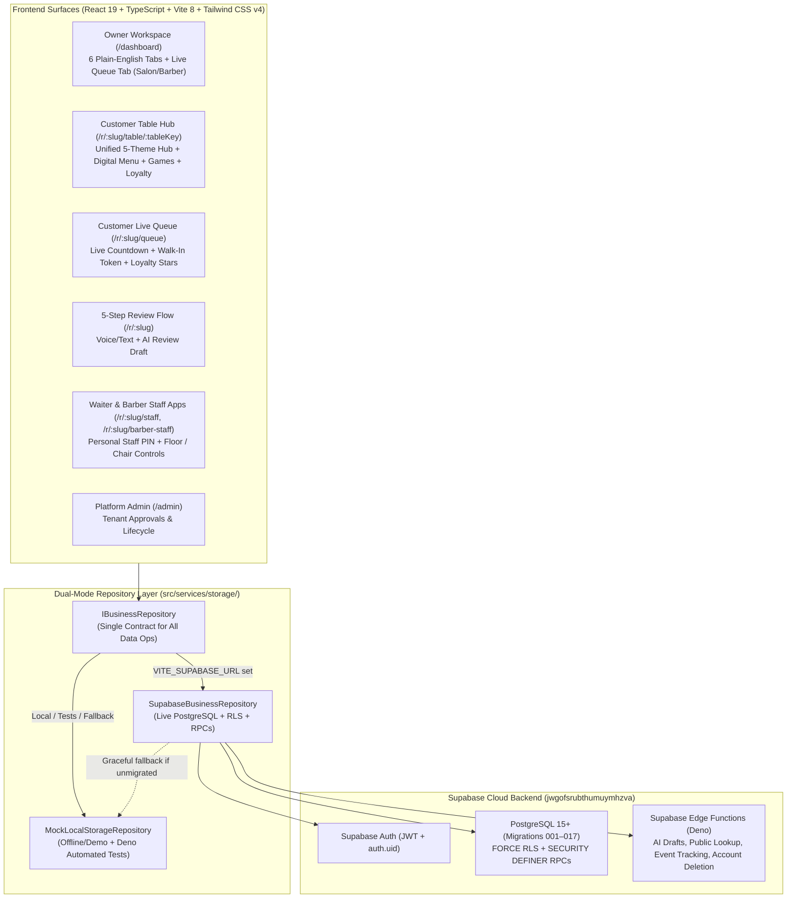
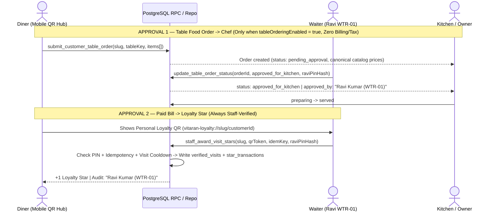

# Vitaran AI Reviews / BistroOS — Complete End-to-End System Architecture

> **Purpose**: Master technical handover & engineering blueprint for AI agents and engineers extending `C:\work\review-saas`. Covers every route, layer, database table, PostgreSQL RPC, security invariant, dual-mode storage pattern, UI design system, and verification test suite.

---

## 1. High-Level System Overview

**Vitaran AI Reviews / BistroOS** is a multi-tenant SaaS platform combining:
1. **AI Google Reviews & Reputation Suite** (5-step guest review flow, AI business reply drafting with Business Knowledge & Local SEO context, sentiment tagging, non-gating compliance, printable QR posters & WhatsApp links).
2. **Restaurant & Cafe Operating Suite (BistroOS)** (`/dashboard` — 5 cultural digital menu templates + 1-tap preset menus, table-specific QR standees, optional phone-to-chef table ordering, server-validated table mini-games with anti-cheat ledger, dual-currency Game Points vs. Loyalty Stars wallet, personal Loyalty QR passes, 6-char reward claim tickets, individual Staff & Waiter Roster with personal PINs, Cafe/Restaurant Monthly Stock & Expenses tracker, and a Mobile Waiter Floor App).
3. **Barber & Salon Live Queue Suite (BarberOS — Module 4 + 4B Upgrade)** (Dedicated Obsidian & Brass studio at `/barber/dashboard` + automatic smart routing from `/dashboard`, cleaner 3-Zone Live Chair & Timer layout, zero-hardware **Hybrid Walk-In (`W-01`) + Online/Phone Appointment (`B-01`) Queue** at `/r/:slug/queue` with Fair Slot-Weaving merge, 15-min double-booking guard, automatic Daily `#1` Token Reset, Personal Customer Token QR Pass, 1-tap `+5 / +10 / +15 / +20 / +30 Min` broadcast delays, Customer Token QR Check-In, standalone Barber Staff Mobile Floor Mode at `/r/:slug/barber-staff`, Daily & Monthly Haircut & Service Revenue Ledger, Shop Entrance QR Standees, and automatic idempotent +1 Loyalty Star crediting upon haircut completion).
4. **Gym Membership & 3-Day Expiry Suite (GymOS — Module 5)** (Dedicated Slate & Volt studio at `/gym/dashboard` + automatic smart routing from `/dashboard`, Front-Desk Member QR Portal at `/r/:slug/gym` for 10-second signups + live Digital Gym Pass with Days Remaining & 1-tap Daily Check-In, Owner Payment Approvals, automatic 3-Day Renewal Radar with 1-tap `+30d Renew` & WhatsApp reminders, and Expired Member check-in lockout).
5. **Multi-Industry Platform Admin Console** (`/admin`) with dedicated separate approval queues (`🍽️ Restaurants & Cafes`, `✂️ Barbers & Salons`, `🏋️ Gyms & Fitness`, and `All Businesses`), bold Industry Module Badges, and 1-click approval & account lifecycle controls.



### Live Production Infrastructure
- **Repository Root**: `C:\work\review-saas` (branch `main`)
- **Production URL**: `https://vitaran-ai-reviews.vercel.app`
- **Supabase Project**: `jwgofsrubthumuymhzva` (`https://jwgofsrubthumuymhzva.supabase.co`)
- **Git Remotes**:
  - `origin`: `https://github.com/pusalalaxmi41-ctrl/reviewassist-saas.git`
  - `legacy-origin`: `https://github.com/pusalalaxmi41-ctrl/saas-review-ai-.git`
- **Tech Stack (Zero Bloated Dependencies)**:
  - Frontend: `react@^19.3.1`, `react-router-dom@^7.18.5`, `lucide-react@^1.67.0`, `qrcode@^1.5.4`, `@supabase/supabase-js@^2.119.0`
  - Styling: `tailwindcss@^4.3.4` (`@tailwindcss/vite`), pure CSS keyframes & theme utility classes in `src/index.css`
  - Tooling: `vite@^8.3.5`, `typescript@~7.0.2`, `oxlint@^1.89.0`, `deno` (automated test runner)

---

## 2. Routing & Application Entrypoints (`src/App.tsx`)

| Route | Layout | Auth Guard | Page Component | Purpose |
| :--- | :--- | :--- | :--- | :--- |
| `/` | `MainLayout` | Public | `src/pages/LandingPage.tsx` | Marketing & product landing page |
| `/login` | `MainLayout` | Public | `src/pages/AuthPage.tsx` | Owner login & signup (Supabase Auth / local mock) |
| `/setup` | `MainLayout` | `RequireAuth` | `src/pages/BusinessSetupPage.tsx` | Onboard new restaurant/cafe workspace |
| `/dashboard` | `MainLayout` | `RequireAuth` | `src/pages/BusinessDashboard.tsx` | **6-Tab Owner Workspace** (`?slug=...&tab=...`) |
| `/admin` | Standalone | `RequireAuth` | `src/pages/admin/AdminPanelPage.tsx` | Platform admin approvals & tenant management |
| `/r/:businessSlug` | `CustomerLayout` | Public | `src/pages/CustomerReviewPage.tsx` | 5-step AI Google Review generator |
| `/r/:businessSlug/menu` | `CustomerLayout` | Public | `src/pages/CustomerRestaurantMenuPage.tsx` | General Customer Table Hub & Digital Menu |
| `/r/:businessSlug/table/:tableKey` | `CustomerLayout` | Public | `src/pages/CustomerRestaurantMenuPage.tsx` | Table-aware QR Hub (pre-binds table for orders & waiter calls) |
| `/r/:businessSlug/staff` | `CustomerLayout` | Staff PIN Gate | `src/pages/RestaurantStaffVerificationPage.tsx` | Waiter Mobile Floor App (Personal Staff ID + PIN) |
| `/r/:businessSlug/queue` | `CustomerLayout` | Public | `src/pages/CustomerBarberQueuePage.tsx` | Barber & Salon Customer Live Queue & Countdown Pass |
| `/r/:businessSlug/barber-staff` | `CustomerLayout` | Barber PIN Gate | `src/pages/BarberStaffQueuePage.tsx` | Standalone Barber Chair Mobile App (Personal `BAR-01` PIN) |
| `/barber/dashboard` | `MainLayout` | `RequireAuth` | `src/pages/BarberOwnerDashboardPage.tsx` | Dedicated 4-Tab BarberOS Owner Studio (Obsidian & Brass) |
| `/gym/dashboard` | `MainLayout` | `RequireAuth` | `src/pages/GymOwnerDashboardPage.tsx` | Dedicated 4-Tab GymOS Owner Studio (Slate & Volt Lime) |
| `/r/:businessSlug/gym` | `CustomerLayout` | Public | `src/pages/CustomerGymPage.tsx` | GymOS Front-Desk Signup, Digital Pass & 1-Tap Daily Check-In |

### Owner Dashboard Architecture (`src/pages/BusinessDashboard.tsx`)
URL query params `?tab=...` map cleanly (with full backwards compatibility for legacy query tabs):
0. `barber_queue` (`?tab=queue` — automatic default primary tab for `'salon'` and `'barber'` businesses) — **Live Queue Controller** (`BarberQueueManagerView.tsx`): Open/Pause Walk-In Queue toggle, **1-Tap Broadcast Delay Bar** (`+5`, `+10`, `+15 Mins`), Now Serving chair card with `Complete Cut (+1 Star) ✓`, Waiting Queue list (`Call to Chair →` / `No-Show`), `+ Add Walk-In` form, Services & Loyalty Rules drawer, and built-in **Live Queue QR Standee** PNG/A5 PDF studio (also switchable inside `QRCodeManager.tsx`).
1. `overview` — **Live Overview & Dual-Approvals**: Business Mode (`Restaurant` | `Cafe`), Experience switch, 3 KPI cards (`QR Scans`, `Game Players`, `Verified Visits`), Low-Stock alert banner, and **Side-by-Side Dual-Approval Center** (**Approval 1: Incoming Table Orders → Chef** and **Approval 2: Waiter Calls & Bill Verifications (+1 Star)**).
2. `menu` — **Digital Menu & 5 Cultural Templates**: Phone Ordering master switch, 5-Template Visual Picker + 1-Tap Preset Menu Injector, Category & Dish CRUD (including optional `imageUrl` and FSSAI dietary tag).
3. `staff` — **Staff & Waiters** (`RestaurantStaffRosterPanel.tsx`): `+ Add Staff / Waiter` form (Full Name, Role, auto-incremented Staff ID `WTR-01`/`CSH-01`/`CHF-01`/`MGR-01`, hashed 4–6 digit personal PIN), Active/Inactive switch, inline `Reset PIN`, and live **"Verified today"** Loyalty QR counter per waiter.
4. `inventory` — **Monthly Stock & Expenses** (`RestaurantMonthlyInventoryPanel.tsx`): Month selector (`YYYY-MM`), Cafe Mode fast-restock templates, 3 summary KPI cards (`Monthly Stock Cost`, `Operating Expenses`, `Low-Stock Items Flagged`), quick-add entry form, and 1-tap `Mark Low Stock ⚠️` toggle.
5. `tables` — **Tables & QRs**: Table grid (`Table 01`, `Table 02`...), live QR canvas previews, and printable PNG / A5 PDF Standee Studio (`src/services/qr/qrGenerator.ts`).
6. `games_loyalty` — **Games, Loyalty & AI Reviews**: Integrated switcher between **Games, Loyalty & Rewards** (table game rules, custom trivia, Star economy rules, Rewards catalogue, collapsible Wi-Fi / Legacy PIN / Suggestion Box) and **AI Reviews** (`CustomerDraftsView`, `QRCodeManager`, `AnalyticsView`, `AIConfigurationSettings`, `BusinessKnowledgeSettings`, `GoogleUrlSettings`). Legacy `?tab=ai_reviews|drafts|qr|analytics|settings` auto-route directly into the AI Reviews sub-view.

---

## 3. Dual-Mode Repository Pattern (CRITICAL ENGINEERING RULE)

Every feature MUST work identically in **both** modes via `src/services/storage/index.ts`:
- **Production Mode (`SupabaseBusinessRepository`)**: Talks directly to Supabase PostgreSQL tables (for owner-authenticated CRUD protected by RLS) and `SECURITY DEFINER` RPCs (for public guest actions and Staff PIN-authenticated floor actions).
- **Local / Test / Fallback Mode (`MockLocalStorageRepository`)**: Persists to `localStorage` (or in-memory fallback in Deno), implements identical validation, multi-tenant isolation checks (`assertOwnerAccess` / `assertOwnerOrStaffPin`), idempotency, cooldowns, and audit logging.

**Whenever you add a new backend capability, ALWAYS follow this 5-file sync order:**
1. `supabase/migrations/0XX_<feature>.sql` — Schema + `ENABLE/FORCE ROW LEVEL SECURITY` + `REVOKE ALL FROM public, anon` + `SECURITY DEFINER` RPCs.
2. `src/types/restaurant.ts` (or domain type file) — Strict TypeScript interfaces & union enums.
3. `src/utils/restaurantValidation.ts` — Pure validators & normalizers (reused by UI, Mock Repo, and Supabase Repo).
4. `src/services/storage/BusinessRepository.ts` — Add method signatures to `IBusinessRepository`.
5. Implement identically in **both** `MockLocalStorageRepository.ts` AND `SupabaseBusinessRepository.ts`.

---

## 4. Complete Database Schema & Migrations (`001` – `017`)

Migrations `001` – `015` are live on Supabase Cloud (`jwgofsrubthumuymhzva`), with Migration `017` upgrading Module 4 (BarberOS Hybrid Walk-In + Appointments, Daily `#1` Token Reset & Service Revenue Ledger):

| Migration | Scope & Tables / Columns Added |
| :--- | :--- |
| `001` – `002` | Core `businesses`, `analytics_events`, `customer_drafts`, rate-limit cleanup schedule |
| `003` | Platform admin roles, `businesses.status` (`pending/active/rejected/suspended`), `account_state` |
| `004` | `business_ai_configs` (tone, length, language, custom instructions) |
| `005` | `business_knowledge_profiles`, `business_target_keywords`, `business_products`, `business_services`, `business_service_areas` |
| `006` – `007` | Review workflow status (`pending/draft_generated/approved/completed`), sentiment, `review_font`, categories |
| `008` | Restaurant Phase 1: `restaurant_profiles`, `restaurant_tables`, `restaurant_menu_categories`, `restaurant_menu_items` |
| `009` | Restaurant Phase 2: `restaurant_game_configs`, `restaurant_customers`, `restaurant_game_sessions`, `restaurant_game_point_transactions` |
| `010` | Restaurant Phase 3: `restaurant_loyalty_rules`, `restaurant_loyalty_star_transactions`, `restaurant_rewards`, `restaurant_reward_claims`, `restaurant_suggestions` |
| `011` | Restaurant Phase 4: `staff_pin_hash`, `min_hours_between_visit_stars`, `restaurant_table_calls`, `restaurant_verified_visits` |
| `012` | Master Upgrade I: `table_ordering_enabled`, `menu_theme_template`, `custom_logo_url`, `custom_accent_color`, `restaurant_table_orders`, 1-tap `apply_restaurant_menu_preset` |
| `013` | Master Upgrade II: `business_mode` (`restaurant`/`cafe`), `restaurant_staff_members`, `restaurant_monthly_inventory`, `verify_staff_member_pin`, `get_public_staff_roster_for_login`, per-waiter audit labeling |
| `014` | Module 4 (Barber & Salon Live Queue): `'barber'` category & staff role, `barber_queue_configs`, `barber_queue_tickets`, plus 5 hardened RPCs (`get_public_barber_queue_status`, `join_barber_queue`, `barber_extend_queue_timer`, `barber_advance_queue_ticket`, `leave_barber_queue_ticket`) |
| `015` | Module 5 (GymOS Membership & 3-Day Expiry Tracker): `'gym'` category constraint update, `gym_configs`, `gym_members`, `gym_check_ins`, plus 6 hardened RPCs (`get_public_gym_portal`, `submit_gym_member_registration`, `lookup_gym_member_pass`, `gym_member_daily_check_in`, `get_gym_owner_dashboard`, `owner_approve_or_renew_gym_member`) |
| `017` | Module 4B (BarberOS Hybrid Queue & Revenue Ledger): `booking_type` (`walk_in`/`appointment`), `display_code` (`W-01`/`B-01`), `scheduled_time`, `scheduled_at`, `price_paise` on `barber_queue_tickets`; Fair Slot-Weaving merge + `bookedSlotsToday` in `get_public_barber_queue_status`; 6-arg `join_barber_queue` with daily `#1` reset & 15-min collision guard; `get_barber_revenue_and_service_summary(p_business_id, p_month_key)` |

### Core Entity Relationships (Restaurant & Cafe Suite)

```mermaid
erDiagram
    businesses ||--o| restaurant_profiles : "1:1 config & theme"
    businesses ||--o{ restaurant_tables : "table QR keys"
    businesses ||--o{ restaurant_menu_categories : "menu sections"
    restaurant_menu_categories ||--o{ restaurant_menu_items : "dishes & prices"
    businesses ||--o{ restaurant_staff_members : "personal IDs & hashed PINs"
    businesses ||--o{ restaurant_monthly_inventory : "monthly stock & expenses"
    businesses ||--o{ restaurant_table_orders : "Approval 1: Order -> Chef"
    businesses ||--o{ restaurant_table_calls : "Waiter & Bill alerts"
    businesses ||--o{ restaurant_verified_visits : "Approval 2: Paid Bill -> Star"
    businesses ||--o{ restaurant_game_configs : "mini-game rules"
    businesses ||--o{ restaurant_game_sessions : "server-seeded rounds"
    businesses ||--o{ restaurant_game_point_transactions : "immutable Game Points ledger"
    businesses ||--o| restaurant_loyalty_rules : "star rules & Wi-Fi"
    businesses ||--o{ restaurant_loyalty_star_transactions : "immutable Loyalty Stars ledger"
    businesses ||--o{ restaurant_rewards : "reward catalogue"
    businesses ||--o{ restaurant_reward_claims : "6-char claim tickets"
    businesses ||--o{ restaurant_suggestions : "private feedback box"
    businesses ||--o| barber_queue_configs : "1:1 barber/salon queue rules"
    businesses ||--o{ barber_queue_tickets : "daily walk-in queue tokens"
    restaurant_customers ||--o{ restaurant_game_sessions : "plays"
    restaurant_customers ||--o{ restaurant_verified_visits : "earns stars"
    restaurant_customers ||--o{ restaurant_reward_claims : "redeems"
    restaurant_customers ||--o{ barber_queue_tickets : "auto-linked loyalty cuts"
```



---

## 5. Key Operational Workflows & Security Invariants

### Dual-Approval Workflow (Never Mix or Blur These Two Steps!)



### Non-Negotiable Security & Business Invariants
1. **Strict Dual-Currency Separation**:
   - **Game Points** (`restaurant_game_point_transactions`) and **Loyalty Stars** (`restaurant_loyalty_star_transactions`) live in **separate immutable ledgers**.
   - Game answers are **always validated server-side** against `server_seed`; client-submitted scores are never trusted.
   - Converting Game Points → Loyalty Stars is strictly governed by `allow_point_exchange`, `points_per_star_exchange`, and `max_stars_via_exchange_per_week`.
2. **QR Scan ≠ Paid Visit**:
   - Scanning a table QR increments `analytics_events (qr_scan)` and awards **0 Loyalty Stars**.
   - Loyalty Stars for dining visits are **only** issued via `staff_award_visit_stars` (authenticated by Owner JWT, individual Staff Member PIN, or legacy shared Staff PIN) with idempotency keys and cooldown enforcement (`min_hours_between_visit_stars`).
3. **Personal Staff PIN Hashing & Audit Integrity**:
   - PINs are salted & SHA-256 hashed client-side via `hashStaffPin(businessSlug, pin)` (`"vitaran-staff-pin:<slug>:<pin>"`). Plaintext PINs are never persisted or returned.
   - `get_public_staff_roster_for_login` strictly returns `{ id, staffCode, fullName, role }` for active staff and **never** returns `pin_hash`.
   - `resolve_staff_member_label(business_id, staff_pin_hash, fallback)` maps a waiter's PIN hash server-side to `"Full Name (WTR-01)"` so waiters cannot spoof another waiter's name in audit logs.
4. **Conditional Table Ordering (Zero Billing / Tax / Payment Gateways)**:
   - When `tableOrderingEnabled === false`, the Digital Menu displays **zero `+ Add` buttons** AND `submit_customer_table_order` rejects submissions server-side.
   - Prices & dish names are always resolved from canonical `restaurant_menu_items` rows, never trusted from the client payload.
5. **No Review Gating**:
   - Negative customer feedback in `/r/:businessSlug` is stored honestly with `'negative'` sentiment and never suppressed or blocked from proceeding.
6. **PostgreSQL SQL Safety Rule**:
   - Always use `pg_catalog.substr(val, 1, N)` — **never** `pg_catalog.substring(val from 1 for N)` (causes `ERROR 42601` in Supabase SQL Editor).
   - Always set `search_path = pg_catalog, public, pg_temp` on every `SECURITY DEFINER` function.
7. **React Linting Rules (`oxlint`)**:
   - Never call `setState` synchronously inside `useEffect` (`react(set-state-in-effect)`).
   - Prefer `crypto.randomUUID()` over `Date.now()` in React purity-checked render/handler code.

---

## 6. Design System & Unified 5-Theme Customer UI

### Owner & Staff Design System (`src/index.css`)
- **Canvas**: Milk (`#F8F9FA`) | **Surface**: Pure White (`#FFFFFF`, `.bistro-card`)
- **Primary**: Midnight Navy (`#1E1B4B`, hover `#2E2A6E`)
- **Accent**: Champagne Gold (`#D2DB76`)
- **Status**: Emerald (`#059669`), Warm Amber (`#D97706`)

### Unified 5 Cultural Templates (`src/config/menuPresets.ts`, `CustomerRestaurantMenuPage.tsx`, `CustomerDigitalMenuView.tsx`)
Both the **Customer Table Hub** (header, loyalty card, 6 horizontal action blocks) AND the **Digital Menu** (Photo Cards view + Classic Compact Indian Menu view + FSSAI Veg/Non-Veg marks + Search) dynamically adapt to `profile.menuThemeTemplate`:

| Theme ID | Preset Key | Visual Style & Inspiration | Signature Tokens |
| :--- | :--- | :--- | :--- |
| `masala` | `masala_indian` | Royal Indian Parchment (Saffron House + Kritunga) | `#7A1624` crimson, `#FDF8EE` parchment, double gold border, maroon pill banners with overlapping bowl photos, serif titles |
| `prakriti` | `prakriti_organic` | Organic Earthy Cafe (Casa Limone) | `#2D4A33` moss green, `#F2ECE1` warm sand, `rounded-3xl` cards, `🌿` leaf headers, `#B85D3B` terracotta accents |
| `bistro` | `bistro_modern` | Sleek Fine Dining (SUMI) | `#141414` charcoal obsidian canvas, `#FAF7F2` crisp sharp `rounded-none` cards, 1px `#C5A880` gold hairlines, numbered uppercase headers (`01`, `02`) |
| `samudra` | `samudra_coastal` | Coastal Seaside & Brunch (Sunday Club) | `#1A365D` ocean navy, `#F5EFE6` sand cream, wavy SVG `#0D9488` turquoise dividers, circular dish photo pill-row cards |
| `sizzler` | `sizzler_diner` | Retro Pop Diner & Grill (Fire & Smoke) | `#DC2626` cherry red + `#FACC15` mustard yellow, checkered diner stripe, `#FEFCE8` cream, `2px solid #111827` comic offset shadows |
| `default` | — | BistroOS Classic | Milk (`#F8F9FA`), Midnight Navy (`#1E1B4B`), Champagne Gold (`#D2DB76`) |

---

## 7. Complete Verification & Deployment Playbook

Run these commands from `C:\work\review-saas` after every change:

```powershell
# 1. Static analysis & TypeScript + Vite production build (must be 0 warnings, 0 errors)
npm run lint
npm run build

# 2. All 13 automated Deno verification suites (383 checks total)
npm run test:qr              # 45 checks — QR URLs, scan tracking, poster rendering
npm run test:ai-config       # 34 checks — AI tone/length/language config & tenant isolation
npm run test:knowledge       # 28 checks — Business Knowledge, SEO, prompt-injection defense
npm run test:reviews         # 25 checks — Sentiment, reply workflow, non-gating, 90-day retention
npm run test:menu            # 30 checks — Phase 1: Profile, tables, categories, dishes, public lookup
npm run test:games           # 20 checks — Phase 2: Server-validated games, anti-cheat, daily caps
npm run test:loyalty         # 22 checks — Phase 3: Separate ledgers, point-to-star exchange, 6-char claims
npm run test:staff           # 20 checks — Phase 4: Floor calls, spam guard, PIN gate, visit cooldown
npm run test:templates       # 33 checks — Upgrade I: 5 templates, 1-tap presets, order->chef flow
npm run test:staff-roster    # 30 checks — Upgrade II: Individual staff PINs, per-waiter audit, monthly stock/expenses
npm run test:barber          # 39 checks — Module 4: Barber/Salon live queue, broadcast delays, BAR-01 PIN, auto +1 Star idempotency & tenant isolation
npm run test:gym             # 27 checks — Module 5 & Multi-Industry Router: Industry locking, Barber Token QR, GymOS signup, payment approval, 3-day expiry radar, daily check-in idempotency & tenant isolation
npm run test:barber-hybrid   # 30 checks — Module 4B: Daily #1 token reset, W-XX/B-XX hybrid slot-weaving merge, double-booking guard, broadcast delay sync, daily & monthly service revenue ledger & tenant isolation

# 3. Git push (both remotes) & Production Vercel Deploy
git push origin main
git push legacy-origin main
npx vercel deploy --prod --yes
```

---

## 8. Clean Extension Points for Next Steps

Future agents can safely build on top of this foundation in any of these directions without refactoring existing layers:
1. **Kitchen Display Screen (KDS) Route (`/r/:businessSlug/kitchen`)**: Reuse `verifyStaffMemberPin` (filtering for `role === 'chef' | 'manager'`) + `getRestaurantFloorAndAnalytics().tableOrders` to render a dedicated tablet landscape Kitchen Queue screen with sound chimes and 1-tap `Start Preparing` → `Mark Ready / Served`.
2. **Menu Import from Real Menu Photo (AI OCR)**: Add an Edge Function accepting an uploaded printed menu photo (like Kritunga / Mehfil / Telugu Tiffin cards), extracting structured `{ categoryName, dishName, subtitle, pricePaise, dietaryTag }` JSON, previewing it in `RestaurantManagerView.tsx`, and batch-inserting via `createRestaurantMenuCategory` + `createRestaurantMenuItem`.
3. **Half / Full or Small / Large Dish Variants**: Add optional `price_variants jsonb` (`[{ label: "Half", pricePaise: 13600 }, { label: "Full", pricePaise: 22000 }]`) to `restaurant_menu_items` (migration `014`) while keeping `price_paise` as the default primary price so all existing menu and order tests stay 100% compatible.
4. **Monthly Staff Performance & Profit Snapshot**: Extend `get_restaurant_floor_and_analytics` or add a monthly report RPC joining `restaurant_verified_visits` (grouped by `verified_by_label`), `restaurant_table_orders` (grouped by `approved_by`), and `restaurant_monthly_inventory` (monthly stock + expense breakdown by category) with 1-tap CSV export.
5. **WhatsApp / Push Real-Time Alerts**: Subscribe to Supabase Realtime channels on `restaurant_table_calls` and `restaurant_table_orders` inside `RestaurantManagerView.tsx` and `RestaurantFloorAndStaffPanel.tsx` to replace or supplement the current 8–10s polling with instant WebSocket updates + audio chime.
